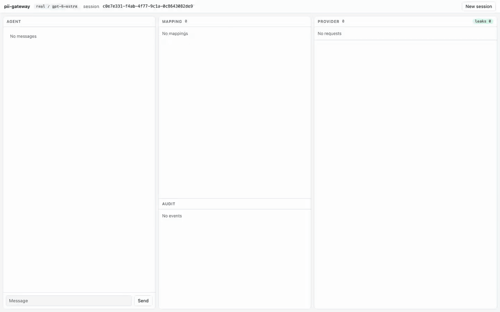

# pii-gateway


[Full video (MP4)](docs/media/demo.mp4)

A local gateway that keeps personal data out of what coding agents send to LLM providers. It sits
between the agent (Claude Code, Codex, Pi, anything speaking the Anthropic Messages, OpenAI Chat or
OpenAI Responses protocol) and the provider, replaces names, e-mails, phone numbers and secrets with
stable typed handles (`<PERSON_1>`, `<SECRET_2>`) in prompts, tool calls and tool output, and puts the
real values back into responses and streamed tool arguments. Mappings are per session and persisted,
so a name keeps the same handle across a whole multi-turn conversation and across restarts. Built on
LiteLLM, Presidio and a modified [Palena](https://github.com/PalenaAI/palena-litellm-pseudonymizer);
a protocol-aware bridge covers the gaps of LiteLLM's stock guardrail path (see `docs/DESIGN.md`).

## Architecture

```
 agent (Claude Code / Codex / Pi)
        |  session header
        v
 LiteLLM proxy :14000 -- pii_bridge (litellm/) --+--> Palena :18080 --> Presidio :15002 (NER + patterns)
        |        walk request, mask, restore     |         |
        |        fail closed, audit, metrics     |         +--> Redis :16379 (session mapping vault)
        v                                        |
 provider (Anthropic / OpenAI / ChatGPT) <-------+  sees handles only
```

## Quickstart

Prerequisites: macOS or Linux, Go (for Palena), [uv](https://docs.astral.sh/uv/), Redis (`redis-server` on PATH or
in `/opt/homebrew/bin`).

```bash
uv sync                      # Python deps incl. spaCy en/ru models (large download)
bash scripts/up.sh           # redis, mock upstream, presidio, palena, litellm (:14000)
bash scripts/status.sh
bash scripts/smoke.sh        # what the mock upstream received vs what the client got back
bash scripts/down.sh
```

The LiteLLM master key comes from `LITELLM_MASTER_KEY`; if unset, a random key is generated once into
`.run/master.key` (mode 600). Runtime state, logs and pids live in `.run/` (gitignored). Ports and optional
variables: `scripts/_env.sh`, `.env.example`.

Demo app (agent loop, session vault, audit tail and the provider's view side by side):

```bash
uv run python demo/server.py --mode mock             # http://127.0.0.1:17000
```

Real providers (second LiteLLM on :14001 behind a capturing mitmproxy; the ChatGPT token is read at runtime from
the Codex auth file, `CODEX_AUTH_FILE`, default `~/.codex/auth.json`):

```bash
uv venv .run/mitm-venv && uv pip install --python .run/mitm-venv/bin/python mitmproxy
bash scripts/real-up.sh
uv run python demo/server.py --mode real --port 17001
bash scripts/canary-repo.sh                          # fake-PII repo (fixtures/canary-repo) for manual agent runs
uv run python scripts/canary_scan.py --session <id>  # leak scan of captured upstream requests
```

Tests (the mock stack must be up for e2e and ui):

```bash
(cd vendor/palena && go vet ./... && go test ./...)
uv run pytest tests/unit                              # no services needed
uv run pytest tests/e2e tests/unit tests/ui -q        # full suite; see tests/e2e/README.md
```

## Pointing agents at it

Use the master key as the client credential (`export LITELLM_MASTER_KEY=$(cat .run/master.key)` if you did not set it).

Claude Code (`/v1/messages`):

```bash
export ANTHROPIC_BASE_URL=http://127.0.0.1:14000
export ANTHROPIC_AUTH_TOKEN="$LITELLM_MASTER_KEY"      # API-key style, with the mock or an API-key upstream
# subscription login through the real stack (:14001): keep the OAuth login and pass the gateway key as a header
# export ANTHROPIC_BASE_URL=http://127.0.0.1:14001
# export ANTHROPIC_CUSTOM_HEADERS="x-litellm-api-key: Bearer $LITELLM_MASTER_KEY"
claude
```

Codex (`/v1/responses`), `~/.codex/config.toml`:

```toml
model_provider = "gateway"
model = "gpt-6-astra"            # whatever litellm/config.real.yaml routes

[model_providers.gateway]
name = "gateway"
base_url = "http://127.0.0.1:14001/v1"
env_key = "LITELLM_MASTER_KEY"
wire_api = "responses"
```

Pi, in `$PI_CODING_AGENT_DIR/models.json` (Pi sends `x-session-id`):

```json
{ "providers": { "gateway": {
    "baseUrl": "http://127.0.0.1:14001/v1", "api": "openai-responses", "apiKey": "<LITELLM_MASTER_KEY>",
    "models": [{ "id": "gpt-6-astra" }] } } }
```

Any other client works the same way: set the base URL and send a stable session header
(`x-claude-code-session-id`, `session-id` or `x-session-id`); without one, multi-turn stability degrades.

## What is and is not covered

Covered: system prompts (pattern-only, see design doc), user text, assistant history, tool calls and arguments, tool
results, streaming and non-streaming, on Anthropic Messages, OpenAI Chat and OpenAI Responses. Thinking and reasoning
items pass through untouched so their signatures stay valid. Secrets (AWS, GitHub, OpenAI/Anthropic keys, JWT, PEM,
`password=...`) are masked and never restored. If Palena or Redis is down, requests are rejected (fail closed).

Limitations:
- Detection is statistical: spaCy NER plus regexes. Names it does not recognise, unusual formats, and entities
  embedded in paths or encodings can slip through; a lone surname that is also a common word may be kept.
- Only English and Russian are configured. Other languages need models and recognizers.
- A name that first appears only in a system prompt is not detected there (system text is scanned with patterns only);
  it is masked once it shows up in user text or tool output.
- Not guarded: WebSocket `/v1/responses`, the `/anthropic/*` and `/openai/*` passthrough routes and `count_tokens`;
  do not expose them to clients. `/v1/responses/compact` requests are masked; the compaction item it returns is opaque. Images, documents, `search_result` blocks and `tools[]` definitions are
  not scanned.
- The gateway protects what leaves your machine toward the provider. It does not protect the local mapping vault
  (Redis) or the audit key; treat both as sensitive.
- Short replies where a model inflects or rewrites a handle may leave a handle unrestored (counted as
  `unknown_handles` in audit events).

## Audit and metrics

The audit log is hash-chained JSONL with handles, counts and keyed fingerprints, never real values. Metrics are
Prometheus text on `:14090/metrics` (mock stack) and `:14091/metrics` (real stack). Details, event schema and
operations: `docs/OBSERVABILITY.md`; verify with `uv run python scripts/audit_verify.py [--session SID] [--fp TYPE VALUE]`.

## License

Apache-2.0, see `LICENSE`. `vendor/palena` is a modified copy of palena-litellm-pseudonymizer (Apache-2.0,
bitkaio LLC); see `NOTICE`.
